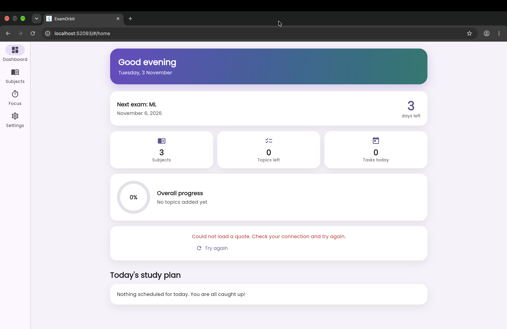
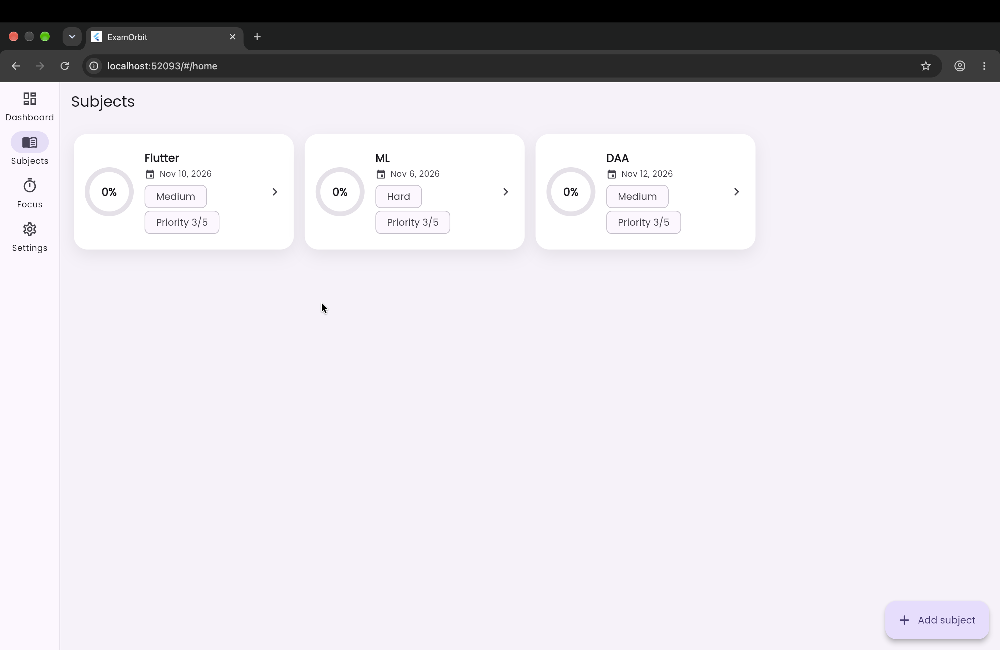
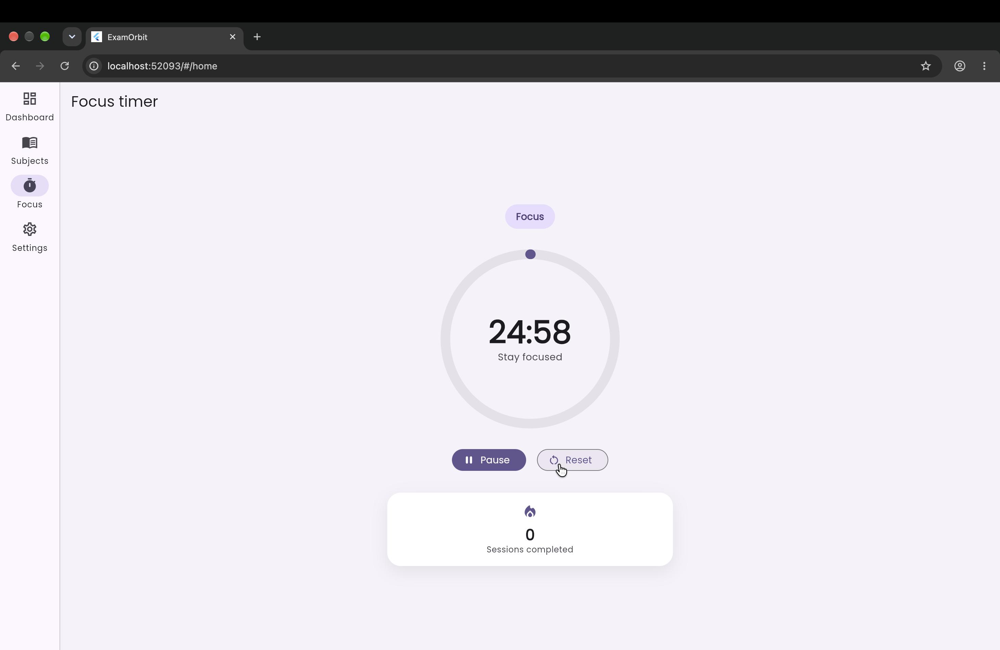
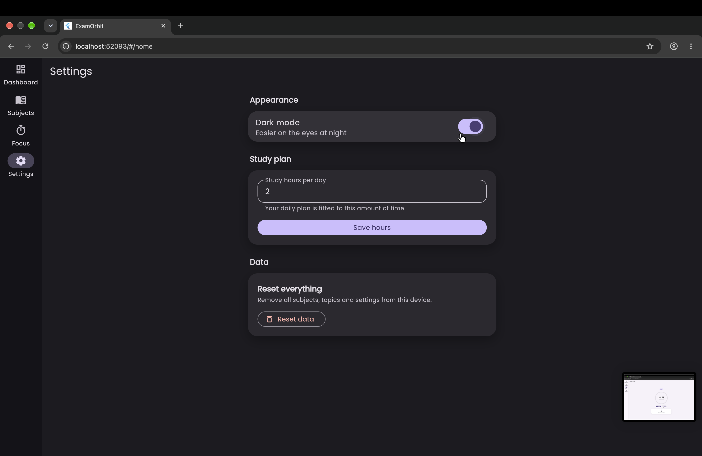

# ExamOrbit

ExamOrbit is a smart exam and syllabus study planner for college students. Add your subjects, exam dates and syllabus units, and ExamOrbit builds a daily study plan that fits the time you have before each exam. Track progress, stay focused with a Pomodoro timer, and see a fresh motivational quote each time you open the app.

## Features

- **Splash screen** with an animated logo that hands off to the app.
- **Dashboard** with a countdown to your next exam, today's study plan, an overall progress ring, quick stats and a motivational quote (with loading, error and retry states).
- **Subjects** list with an animated progress ring, exam date, difficulty and priority on every card.
- **Subject detail** with expandable units and topic checklists. Ticking a topic animates the progress bars and rings.
- **Add / edit subject** form with full validation and inline error messages.
- **Auto-generated study plan** that spreads your remaining topics across the days left before each exam, weighted by difficulty and priority.
- **Focus timer** running 25 minute focus sessions and 5 minute breaks, with an animated pulsing ring, start / pause / reset and a session counter.
- **Settings** with a light / dark theme toggle, daily study hours and a reset-data option.
- **Responsive layout**: a bottom navigation bar on phones and a side navigation rail on wider screens.
- **Offline-friendly storage**: all data is saved on the device with shared preferences, so it survives restarts.

## Screenshots

_Screenshots coming soon._

| Dashboard | Subjects | Focus timer |
| --- | --- | --- |
| _placeholder_ | _placeholder_ | _placeholder_ |

## Getting started

Requirements: Flutter 3.27 or newer (Dart 3.6 or newer).

```bash
flutter pub get
flutter run
```

To run the tests:

```bash
flutter test
```

If the platform folders (`android/`, `ios/`, `web/`) are missing from your copy of the project, generate them once with `flutter create . --platforms=android,ios,web` in the project folder. Your existing `lib/` and `test/` files are left as they are.

## How the study plan works

`PlannerService` (in `lib/services/planner_service.dart`) builds the plan:

1. Each pending topic is given a study time based on its subject's difficulty (30 min for easy, 45 min for medium, 60 min for hard).
2. Topics are ordered by urgency: subjects with the nearest exam first, then higher priority, then longer topics.
3. Each topic goes on the least busy day between today and the day before its exam that still fits within your daily study hours. If nothing fits, it goes on the least busy day so no topic is dropped.
4. Exams that have already passed are ignored, and an exam today leaves today as its only study day.

## Folder structure

```
examorbit/
├── lib/
│   ├── main.dart                 # App bootstrap and state loading
│   ├── app.dart                  # Root MaterialApp with themes and routes
│   ├── models/                   # Plain data classes (subjects, units, topics, settings)
│   ├── routes/
│   │   └── app_routes.dart       # Central named-route table with page transitions
│   ├── screens/
│   │   ├── splash_screen.dart
│   │   ├── home_shell.dart       # Bottom bar / navigation rail
│   │   ├── dashboard_screen.dart
│   │   ├── subjects_screen.dart
│   │   ├── subject_detail_screen.dart
│   │   ├── subject_form_screen.dart
│   │   ├── focus_timer_screen.dart
│   │   └── settings_screen.dart
│   ├── services/
│   │   ├── planner_service.dart  # Study plan generation (unit tested)
│   │   ├── storage_service.dart  # Saves and loads data with shared preferences
│   │   └── quote_service.dart    # Fetches motivational quotes over HTTP
│   ├── state/
│   │   └── app_state.dart        # Provider state shared across screens
│   ├── theme/
│   │   └── app_theme.dart        # Light and dark ThemeData and brand colors
│   ├── utils/                    # Date helpers, id generation, form validators
│   └── widgets/                  # Reusable ProgressRing, SubjectCard, StatTile, QuoteCard, AppCard
├── test/
│   ├── planner_service_test.dart # Plan generation and edge cases
│   └── subject_form_test.dart    # Add Subject form validation
├── analysis_options.yaml
├── pubspec.yaml
└── README.md
```

## Packages

- `provider` for state management
- `shared_preferences` for local persistence
- `http` for the quote API
- `intl` for date formatting
- `google_fonts` for the Poppins typeface

## Notes

- The dashboard quote comes from the public ZenQuotes API (`https://zenquotes.io/api/random`) and needs an internet connection. The rest of the app works offline.
- Data lives on the device where you use the app. Use Settings, then Reset data, to clear it.
## 📸 Application Screenshots

### 1. Dashboard


### 2. Subjects


### 3. Focus Timer


### 4. Settings
